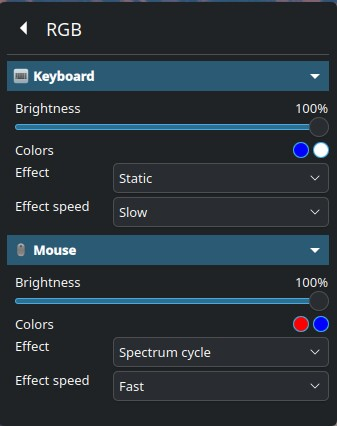

# rgb-backlight

Control del RGB de teclados y ratones gaming USB desde **KDE Plasma**, con un
módulo de kernel propio. Nació de una pregunta muy simple: *«¿por qué el
control de brillo del teclado en Plasma no hace nada?»*.

Spoiler: porque en Linux **no existe** ningún driver para estos teclados, así
que nunca se creó el LED `kbd_backlight` que UPower busca, y por lo tanto el
deslizador de Plasma no tenía nada que controlar.

Con este proyecto:

* el **teclado MSI Mystic Light** (1462:1562) se controla con el deslizador
  **nativo de Plasma** (UPower → PowerDevil), igual que el brillo de una
  pantalla;
* el **ratón Razer Viper Mini** (1532:008a) se controla con su propio LED;
* y ambos aparecen en un panel **RGB** dentro del widget *KDE Control
  Station*, con brillo, color, efecto y velocidad.

## Captura



*Sección **RGB** del widget KDE Control Station: una entrada plegable por
dispositivo (teclado y ratón), con brillo, colores, efecto y velocidad.*

---

## Cómo funciona

### 1. El módulo de kernel (`rgb-backlight.ko`)

Expone dos dispositivos de la clase `leds`:

| LED | Dispositivo | Lo ve UPower |
|---|---|---|
| `msi::kbd_backlight` | teclado MSI | ✅ (el nombre contiene `kbd_backlight`) |
| `razer::logo_backlight` | ratón Razer | ❌ (UPower solo busca teclados) |

**Teclado MSI.** El firmware del Mystic Light solo aplica el brillo si el
paquete incluye un color, y nunca devuelve su estado. Para poder cambiar el
brillo sin perder el color ni el efecto que haya puesto OpenRGB, el módulo
**toma el control del dispositivo HID** (igual que hacen `hid-asus` o
`hid-razer` en el árbol de Linux) e **intercepta todos los paquetes** que se
envían al teclado. El último se memoriza y se reenvía con el brillo nuevo.

El firmware del teclado lo enciende por su cuenta (en *blanco estático*)
cuando el dispositivo termina de inicializarse, y el módulo no sabe en qué
estado está hasta que alguien escribe. De eso se encarga el **perfil** (ver
más abajo): se aplica en cuanto arranca el sistema, así que el blanco del
firmware solo se ve un instante. Si OpenRGB está abierto, su perfil se
aplica después y gana, como es lógico.

**Ratón Razer.** Aquí el brillo es un comando independiente, así que no hace
falta interceptar nada: se habla directamente el protocolo *Razer device
command*. Detalle importante: **Linux no deja enviar ese `feature report`
desde userspace** (el descriptor del ratón no lo declara), por lo que es
imprescindible hacerlo desde el módulo.

### 2. El plugin QML (`org.rgb.backlight`)

Tipo QML `RgbDeviceControl`, escrito en C++, que expone:

```qml
RgbDeviceControl {
    device: "keyboard"   // o "mouse"
    // available, brightness, color, secondaryColor, effect, speed
}
```

El brillo del **teclado** se escribe vía D‑Bus (`org.freedesktop.UPower.KbdBacklight`),
igual que hace PowerDevil, para no pelearse con el valor que UPower tiene
cacheado. Los atributos de color/efecto/velocidad se escriben en `sysfs`.

### 3. El panel del widget

`widget-patch/` contiene los cambios del widget *KDE Control Station*
(https://github.com/EliverLara/kde-control-station): una página **RGB** con
una sección plegable por dispositivo (icono + flechita) y dentro los controles
de brillo, colores, efecto y velocidad.

---

## Protocolos (documentados en el código)

### MSI Mystic Light — `feature report` 0x02, 64 bytes

```
[0] report id (0x02)
[1] packet id
[2] mode      0=off 1=static 2=breathing 3=flash 4=double flash 5=cycle 6=smooth cycle
[3] speed     0=low 1=medium 2=high
[4] brightness 0=off, 1..10 = 10%..100%
[5] número de colores (0..7)
[6..] colores (R, G, B)
```

`num_colors = 0` deja el firmware sin color → el teclado se apaga. Por eso
hay que reenviar siempre el último paquete conocido con el brillo nuevo.

### Razer Viper Mini — *device command* de 90 bytes (clase `0x0f`)

```
[0] report id (0x00)
[1] status            [2] transaction id (0x3f para la iluminación)
[3..4] packets        [5] protocol     [6] data size
[7] command class     [8] command id   [9..] argumentos
[89] checksum (XOR de [3..88])        [90] reservado
```

Efectos (*extended matrix*, clase `0x0f`, cmd `0x02`):

| Efecto | id | argumentos tras la cabecera |
|---|---|---|
| Off | 0x00 | `00 00 00` |
| Static | 0x01 | `00 00 01` + RGB |
| Breathing (random/single/dual) | 0x02 | `01 00 01` + RGB (o `02 00 02` + 2×RGB) |
| Spectrum | 0x03 | `00 00 00` |
| Wave | 0x04 | dirección `01` + velocidad `28` + `00` |
| Reactive | 0x05 | `00` + velocidad + `01` + RGB |

Brillo: clase `0x0f`, cmd `0x04`, argumentos `storage(01)`, `led(04)`, valor 0‑255.

> Formato verificado contra [OpenMouse](https://github.com/OpenMouse-Project/mouse-protocol)
> (`src/razer/codec.ts`) y [OpenRazer](https://github.com/openrazer/openrazer).

---

## Instalación

```bash
git clone https://github.com/diegraldev/rgb-backlight.git
cd rgb-backlight
sudo ./install.sh
```

`install.sh` se ocupa de todo:

1. compila e instala el módulo con **DKMS** (se recompila solo al actualizar el kernel);
2. compila e instala el plugin QML en `/usr/lib64/qt6/qml/org/rgb/backlight/`;
3. instala las reglas **udev** que permiten al usuario escribir los atributos
   y desactiva `systemd-backlight` para estos LED;
4. habilita la carga automática del módulo;
5. instala el **perfil** y los dos servicios que lo aplican: al arrancar el
   sistema y al iniciar sesión;
6. reinicia `upower` y `powerdevil`.

Después, en el widget *KDE Control Station* → *Edit controls* → *Add new item* →
**RGB**.

### El estado se recuerda entre reinicios (perfil)

Encender la PC y encontrarte el teclado en blanco y el ratón con otro color
es lo normal: cada dispositivo arranca con lo que le apetece. Este proyecto
lo resuelve guardando un **perfil** con el estado de cada dispositivo y
devolviéndolo al arrancar.

* **Guardar**: lo hace el plugin del widget, en cada cambio que aplicas
  (`~/.config/rgb-backlight/<dispositivo>.state`). Las escrituras se agrupan
  con un temporizador de 300 ms (al arrastrar un deslizador se generan decenas
  de cambios) y se hacen de forma **atómica** (`QSaveFile`), así que el perfil
  nunca queda a medias. El formato es clave=valor, legible y editable a mano:

  ```ini
  # teclado
  colors=db0000,ffffff
  mode=1
  speed=0
  brightness=100
  ```

* **Restaurar al arrancar**: `rgb-backlight-restore.service` (servicio de
  sistema) aplica el perfil en cuanto el sistema está listo, **antes de que
  entres**, así que el teclado y el ratón ya están como los dejaste desde el
  principio. El perfil es tuyo, no del sistema: el instalador anota de qué
  usuario es en `/var/lib/rgb-backlight/owner` para que el servicio sepa de
  dónde leerlo (el módulo del kernel no puede leer ficheros).

* **Restaurar al iniciar sesión**: `rgb-backlight-session.service` lo vuelve a
  aplicar al entrar, como red de seguridad por si PowerDevil o el firmware
  tocaron algo entre medias. Ambos aplican el perfil por la misma vía que el
  panel (UPower para el brillo del teclado, sysfs para el resto) y escriben
  solo lo que haya cambiado.

* **Reflejarse en el widget**: el plugin lee el estado directamente del módulo
  al abrir la página, así que lo que ves es siempre el estado real.

También se puede manejar a mano:

```bash
~/.local/share/rgb-backlight/rgb-profile.sh show      # perfil + estado real
~/.local/share/rgb-backlight/rgb-profile.sh save      # guardar el estado actual
~/.local/share/rgb-backlight/rgb-profile.sh restore   # aplicar el perfil
```

### Por qué se desactiva `systemd-backlight`

systemd también guarda el brillo de los LED al apagar y lo restaura al
arrancar (`systemd-backlight@leds:...service`). Eso escribe el LED por su
cuenta y, como el módulo reenvía un paquete completo al cambiar el brillo,
acaba encendiendo el teclado en blanco antes de que el perfil haga su
trabajo.

`install.sh` enmascara esas dos instancias para que la única fuente de
verdad sea el perfil, que además del brillo guarda colores, efecto y
velocidad.

### Si el widget se actualiza desde GitHub y se pierden los cambios

```bash
~/rgb-backlight/restore-widget.sh
systemctl --user restart plasma-plasmashell.service
```

### Otros comandos

```bash
~/rgb-backlight/verify.sh    # estado del módulo, los LEDs, UPower y Plasma
~/rgb-backlight/test.sh      # prueba automática de los dos dispositivos
sudo ~/rgb-backlight/uninstall.sh
```

---

## Requisitos

* Kernel ≥ 5.x con `CONFIG_HID`, `CONFIG_LEDS_CLASS` y `CONFIG_DKMS` (Fedora ✓).
* `dkms`, `gcc`, `make` y las cabeceras del kernel (`kernel-devel`).
* Para compilar el plugin QML: `qt6-qtdeclarative-devel`.
* Plasma 6 con el widget *KDE Control Station* (opcional: sin el widget, el
  brillo del teclado sigue funcionando de forma nativa en el OSD de Plasma).

---

## Limitaciones conocidas

* El perfil se guarda cuando cambias algo **desde el panel**. Si configuras
  los dispositivos con OpenRGB, el perfil no se entera: al reiniciar se
  aplicará el último estado guardado por el widget.
* El brillo que muestra el panel es el último que aplicó este proyecto; no
  se lee del hardware (el Razer sí lo permitiría, el MSI no).
* Si el ratón está en un modo de efecto, el selector de color deja de verse
  (es el propio firmware quien ignora el color).
* El brillo del teclado pasa por UPower, así que **OpenRGB y el panel KDE se
  pisan** entre ellos: el último que escriba gana.
* Este proyecto habla el protocolo de estos dispositivos; no es endorsed por
  MSI ni por Razer.

---

## Licencia

GPL-2.0 (el módulo de kernel) — ver [LICENSE](LICENSE).
